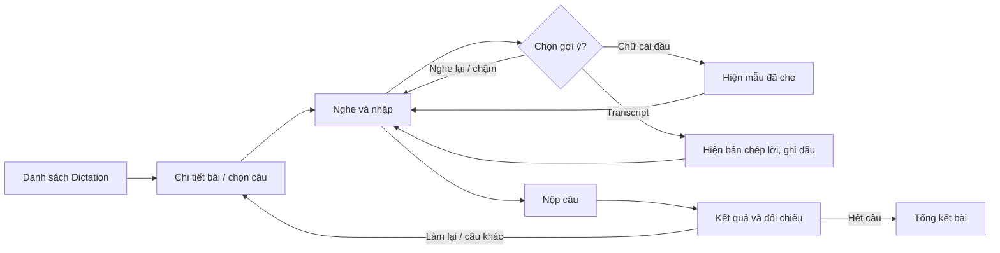

# Thiết kế UC-02 và UC-03: Luyện tập Dictation

**Phạm vi:** Học viên luyện nghe chép chính tả và sử dụng gợi ý trong Module Dictation.  
**Cơ sở dữ liệu:** `lessons`, `lesson_sentences`, `user_attempts`, `scores`, `review_lists`, `system_configs`. Riêng việc ghi nguồn/điểm gần nhất của từ ôn và tiến độ micro-lesson được đặc tả tại [UC-06/07](UC-06-07-dashboard-review.md).

## 1. Mục tiêu và phạm vi

- **UC-02 – Làm bài luyện tập Dictation:** Học viên chọn bài đã xuất bản, nghe audio theo câu, nhập nội dung nghe được, nộp bài và xem điểm cùng phần đối chiếu.
- **UC-03 – Sử dụng gợi ý khi làm bài Dictation:** Trong lúc làm UC-02, học viên có thể nghe lại/chậm lại, xem chữ cái đầu từng từ hoặc bật bản chép lời. Hệ thống ghi nhận việc bật transcript trong `user_attempts.used_transcript_hint`.
- UC-03 là luồng mở rộng trong phiên UC-02, không tạo một attempt riêng.
- Phiên bản đầu chấm khi học viên nộp câu. Audio dùng mốc `start_time`/`end_time` của câu; `words_json` cấp mốc phát từng từ khi phát lại.

## 2. Tác nhân, điều kiện và hậu điều kiện

| Mục | Mô tả |
|---|---|
| Tác nhân chính | Học viên đã đăng nhập |
| Điều kiện trước | Tài khoản còn hoạt động; bài học `PUBLISHED`; học viên có quyền truy cập bài (bài premium yêu cầu quyền Premium còn hạn) |
| Thành công | Attempt Dictation được lưu `COMPLETED`; điểm, lỗi và transcript đúng của câu được trả về để hiển thị |
| Rời giữa chừng | Bản nháp được lưu tạm ở trình duyệt; chỉ gửi câu/lượt cuối khi hoàn tất |
| Lỗi xử lý | Attempt chuyển `FAILED` nếu lỗi xảy ra sau khi đã tạo attempt; giao diện cho phép thử nộp lại có kiểm soát |

## 3. Luồng UC-02

1. Học viên mở danh sách bài Dictation. API chỉ trả bài `PUBLISHED`; bài Premium được đánh dấu khóa nếu học viên chưa có quyền.
2. Học viên chọn bài. Backend kiểm tra Premium trước khi trả dữ liệu. API trả câu theo `startTime`/`endTime`, `textContent`, `words_json`; Frontend giữ transcript trong bộ nhớ để chấm real-time.
3. Học viên chọn chế độ Fill-in-blanks hoặc Full Dictation. Audio phát đoạn tương ứng; player hỗ trợ tua/lặp lại và chỉnh tốc độ.
4. Học viên nhập câu vào textarea. Có thể sửa nội dung trước khi nộp.
5. WER/Levenshtein chạy phía client sau debounce 150 ms, bôi đỏ từ sai khi nhập. Học viên nhấn Enter/Xác nhận câu để chốt điểm; Retry xóa nội dung và điểm cũ, chỉ lượt cuối được gửi.
6. Giao diện nhận kết quả, hiển thị điểm chính xác, câu đúng, câu trả lời và các từ sai/thiếu/thừa; cho phép nghe lại, làm lại hoặc chuyển câu tiếp theo.
7. Khi hết câu, hiển thị tổng kết: số câu hoàn tất, điểm trung bình, thời gian và trạng thái đạt mục tiêu. Không đánh đồng điểm trung bình câu với WER toàn bài; đặt tên chỉ số rõ ràng.

### Luồng thay thế / lỗi

- Bài không tồn tại/đã ẩn: `404`; không khởi tạo phiên.
- Bài Premium nhưng học viên không đủ quyền: `403` với mã `PREMIUM_REQUIRED`; giao diện hiển thị khóa và đường dẫn nâng cấp.
- Nội dung rỗng hoặc quá dài (ví dụ trên 5.000 ký tự): `400`; giữ nguyên bản nháp.
- Mất kết nối khi nộp: giữ bản nháp ở local storage để học viên gửi lại khi có mạng.
- Mất kết nối: giữ nội dung ở client, cho gửi lại; không đưa transcript vào local storage.

## 4. Luồng UC-03 – gợi ý

Các gợi ý khả dụng ở màn hình câu đang làm:

| Gợi ý | Hành vi giao diện | Dữ liệu / quy tắc |
|---|---|---|
| Nghe lại câu | Phát lại đoạn audio câu hiện tại | Không làm lộ transcript; không thay đổi điểm |
| Nghe chậm | Phát ở tốc độ 0,75x (và 1x để trở lại) | Dùng `HTMLMediaElement.playbackRate`; không đổi file audio |
| Gợi ý tăng dần | Nút Gợi ý lần lượt mở một phần từ/câu | Cấp 1/2/3 trừ mặc định 5/10/20 điểm; cấu hình qua `dictation.hint_penalties`; chỉ lượt cuối được tính |
| Transcript | Toggle hiện/ẩn nguyên văn câu | Transcript đã tải sau kiểm tra quyền Premium; attempt ghi `used_transcript_hint=true` nếu từng bật, kể cả khi ẩn lại |

Học viên có thể dùng nhiều gợi ý liên tiếp. Mức trừ điểm cụ thể hóa yêu cầu SRS “trừ theo mức độ”; mặc định 5/10/20, Admin có thể điều chỉnh. Schema không lưu cấp gợi ý nên client gửi `hintCount`, backend tính lại điểm theo cấu hình khi nộp.

## 5. Thiết kế giao diện

### Bố cục desktop

```text
┌──────────────────────────────────────────────────────────────────┐
│ Shadowtation   Dictation / [Tên bài]                 [Tiến độ 2/8]│
├───────────────────────┬──────────────────────────────────────────┤
│ CÂU HỎI               │ CÂU 2                                    │
│ 1  ✓                  │  ┌────────────────────────────────────┐  │
│ 2  Đang làm           │  │ Audio:  ▶  ━━━━━●━━━━  0:03 / 0:06 │  │
│ 3  Chưa làm           │  └────────────────────────────────────┘  │
│ ...                   │ [Nghe lại] [0.75×] [Chữ cái đầu] [Aa]   │
│                       │ ┌──────────────────────────────────────┐ │
│                       │ │ Nhập nội dung bạn nghe được...       │ │
│                       │ └──────────────────────────────────────┘ │
│                       │                  [Nộp câu] [Câu tiếp]   │
└───────────────────────┴──────────────────────────────────────────┘
```

- Thanh tiêu đề có breadcrumb, tiêu đề/cấp độ và tiến độ; danh sách câu cho phép quay lại xem kết quả câu đã nộp.
- Khu audio có play/pause, tua trong đoạn, thời lượng, tốc độ; mọi nút có trạng thái focus và nhãn hỗ trợ screen reader.
- Transcript hiển thị trong vùng riêng, tương phản nền nhẹ, không chèn vào ô trả lời.
- Kết quả câu dùng nhãn + màu: đúng, sai/thay thế, thiếu, thừa. Màu không phải tín hiệu duy nhất.
- Mobile xếp một cột: audio và ô nhập trước, điều hướng câu ở dưới; nút Nộp luôn dễ chạm.
- Trạng thái phải thiết kế: tải bài, đang phát, đang gửi, câu đã chấm, transcript đang tải, premium khóa, lỗi API và bài đã hoàn thành.

### Wireflow



## 6. Thiết kế API

Prefix `/api/v1`; các route cần JWT và lấy `userId` từ principal, không nhận `userId` từ body/query.

| Method / route | Mục đích | Phản hồi chính |
|---|---|---|
| `GET /practice/dictation/lessons` | Danh sách bài đã xuất bản và quyền truy cập | `items: [{id,title,level,audioUrl,isPremiumOnly,access,sentenceCount}]` |
| `GET /lessons/:lessonId/sentences` | Kiểm tra bài và quyền Premium; trả transcript để chấm client | `{lesson,sentences:[{id,startTime,endTime,textContent,wordsJson}]}` |
| `POST /practice/dictation/submit` | Gửi câu/lượt cuối để lưu attempt và Review List | `{lessonId,answers:[{sentenceId,textInput,hintCount,usedTranscriptHint}]}` |

Tất cả route yêu cầu JWT. Backend xác thực câu thuộc bài, tính lại WER/penalty trong transaction; không tin điểm client gửi. Tạo một `user_attempts`/`scores` cho mỗi câu. Audio lấy từ `lessons.audio_url`.

Mẫu kết quả chấm:

```json
{
  "attemptId": "uuid",
  "status": "COMPLETED",
  "accuracyScore": 80,
  "wer": 0.2,
  "usedTranscriptHint": false,
  "transcript": "Good morning, how are you today?",
  "wordErrors": [
    { "reference": "morning", "submitted": "mourning", "errorType": "SUBSTITUTION" }
  ]
}
```

`wordErrors` là view model của API; `scores.words_score_detail` dùng các nhãn `None`, `Substitution`, `Omission`, `Insertion` trong JSONB. `Substitution` được thêm vào kiểu TypeScript; không cần migration vì cột JSONB không có CHECK trên loại lỗi.

## 7. Thuật toán chấm

1. Chuẩn hóa Unicode về NFC, chuyển chữ thường, bỏ dấu câu ở biên token, chuẩn hóa khoảng trắng; giữ dấu nháy trong từ (ví dụ `don't`). Không xóa dấu tiếng Anh đặc biệt bên trong token.
2. Tokenize transcript tham chiếu `R` và câu trả lời `H` theo khoảng trắng sau chuẩn hóa.
3. Tính Levenshtein trên token bằng dynamic programming, lưu backpointer. Chi phí bằng 1 cho substitution, deletion, insertion; bằng 0 cho match.
4. Backtrack để lấy số `S`, `D`, `I` và căn chỉnh từ, phục vụ phản hồi chi tiết. Quy tắc phá hòa cố định: match, substitution, deletion, insertion theo thứ tự để kết quả lặp lại ổn định.
5. `WER = (S + D + I) / max(|R|, 1)`. `accuracyScore = max(0, round(100 × (1 − WER)) − hintPenalty)`. Câu trả lời rỗng là toàn bộ deletion, điểm 0 trước khi trừ gợi ý.
6. Khi nộp bài, backend tính lại điểm, tạo attempt `type=DICTATION`, `textInput`, `status=COMPLETED`, `usedTranscriptHint`; lưu `scores.overall_score=accuracyScore`, `accuracy_score=accuracyScore`, fluency/completeness là `NULL` và chi tiết từ trong transaction.
7. Nếu dự án bật review list: từ bị bỏ/thay thế được upsert vào `review_lists` theo `(user_id, weak_word)`; tăng `wrong_count`, cập nhật `priority_score` theo chính sách review hiện hành. Không tạo mục cho từ thừa vì không có từ tham chiếu tương ứng.

Với câu nhiều từ, ma trận có kích thước `(|R|+1) × (|H|+1)`, độ phức tạp `O(|R||H|)`; giới hạn input trước khi tính. Điểm câu độc lập nhau. Điểm toàn bài hiển thị trung bình số học các `accuracyScore` của các câu đã nộp; nếu muốn WER toàn bài chuẩn cần cộng `S+D+I` và tổng số từ tham chiếu, hiện schema không lưu các tổng này riêng.

## 8. Tương tác dữ liệu và kiểm soát truy cập

- Tất cả lookup bài/câu phải ràng buộc trạng thái bài `PUBLISHED`; không tin ID do client gửi.
- Kiểm tra premium trên server ở metadata, audio URL và mọi endpoint transcript/submit; ẩn nút trên UI chỉ là tiện ích.
- Transcript chỉ được trả sau kiểm tra quyền Premium; Toggle hiển thị/ẩn tức thời.
- Transaction khi ghi kết quả để attempt và score không lệch nhau.
- Endpoint kết quả xác thực `attempt.userId === currentUser.id`; giới hạn tần suất xin transcript và submit.
- Không ghi câu trả lời/transcript vào log ứng dụng. Dùng timeout và thông báo lỗi rõ ràng.

## 9. Tiêu chí nghiệm thu thiết kế

- Học viên thấy danh sách bài, quyền truy cập, cấp độ và số câu; không lấy được transcript qua response bài.
- Audio giới hạn theo câu, có replay và tốc độ chậm; nhập và nộp câu hoạt động bằng bàn phím.
- Transcript toggle hiển thị đúng câu và cờ `used_transcript_hint` không trở về false khi tắt.
- Chấm đúng các trường hợp khớp, viết hoa/thường, dấu câu, substitution, omission, insertion, câu trả lời trống.
- Kết quả có điểm, đối chiếu và trạng thái; bản nháp vẫn còn sau lỗi mạng.
- Quyền Premium, trạng thái bài, ownership và phản hồi lỗi được kiểm tra ở backend.
- Giao diện có bố cục mobile, loading/error/empty/locked/submitting/completed và nhãn tiếp cận được.

## 10. Ghi chú trước khi triển khai

Schema có cờ transcript nhưng không lưu cấp gợi ý; `hintCount` gửi kèm câu trả lời và backend tính lại penalty theo `system_configs.dictation.hint_penalties`. Mặc định 5/10/20 là chính sách cấu hình để cụ thể hóa yêu cầu SRS, không cần migration. Bản nháp giữa bài lưu local storage.
